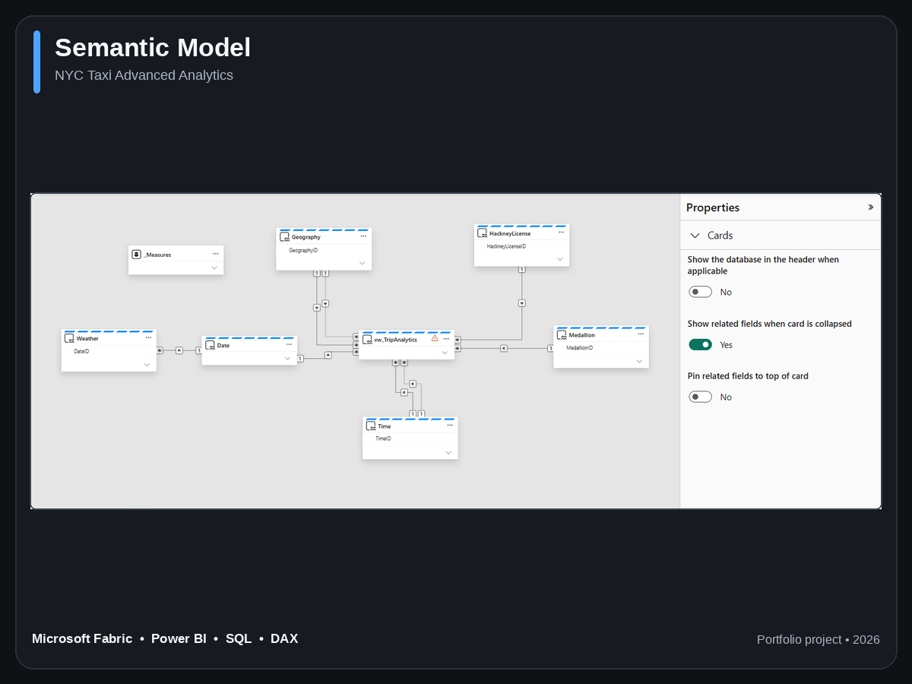
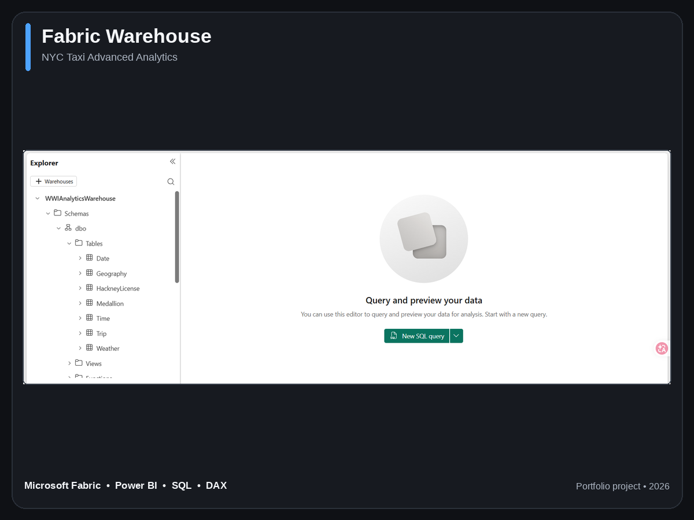
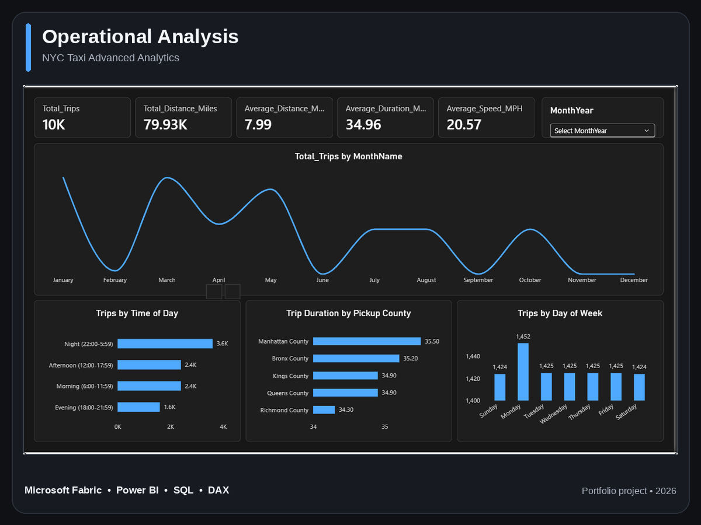
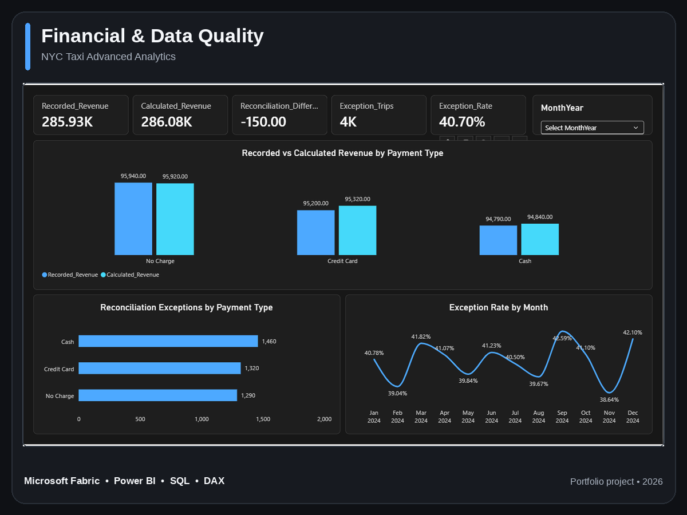
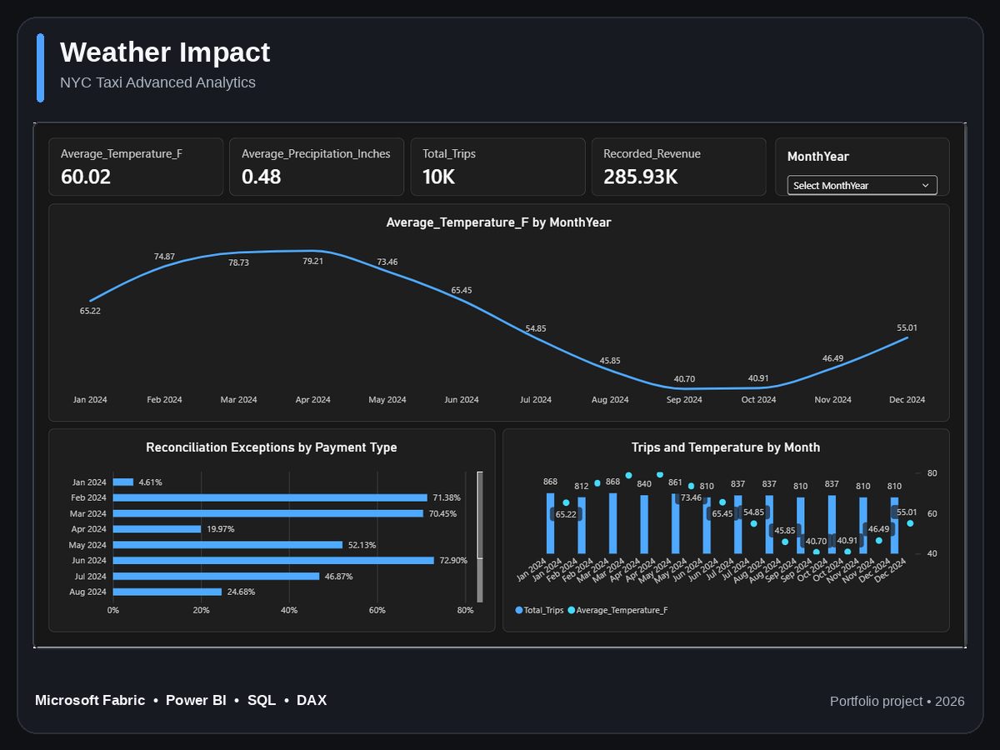
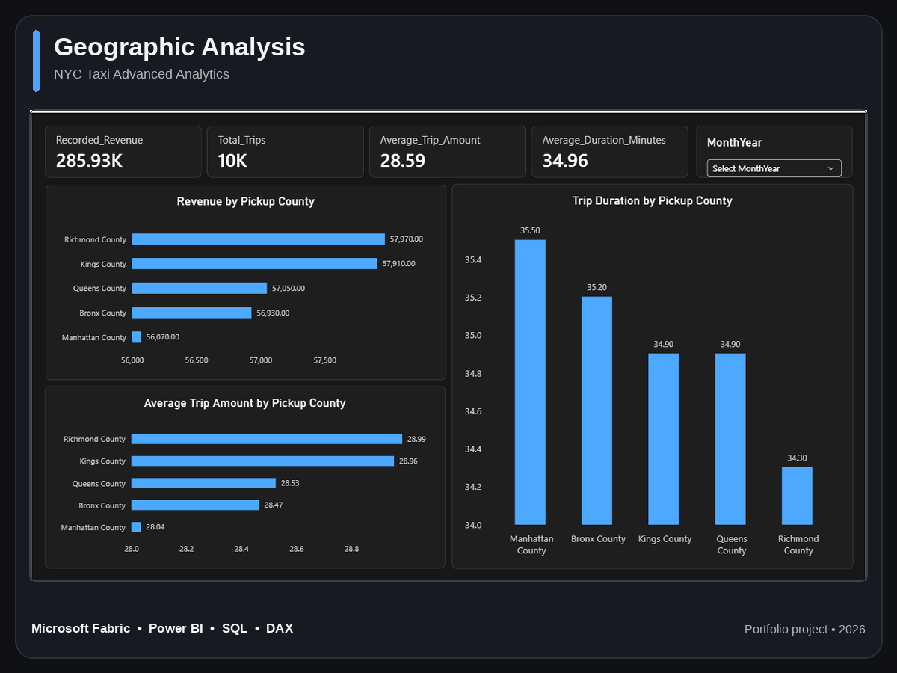
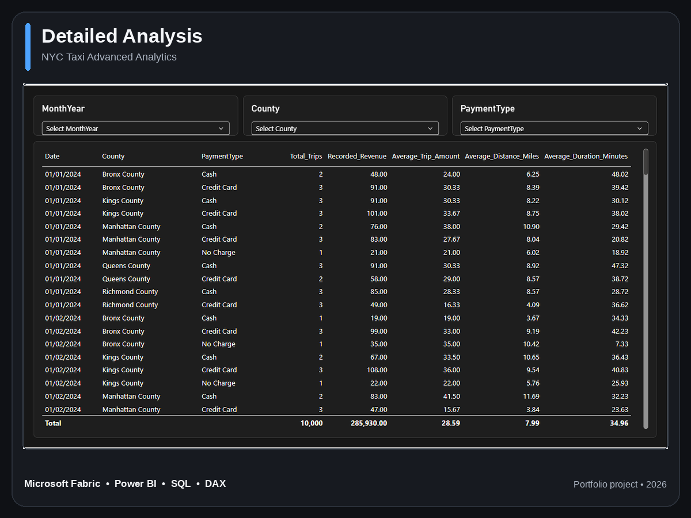
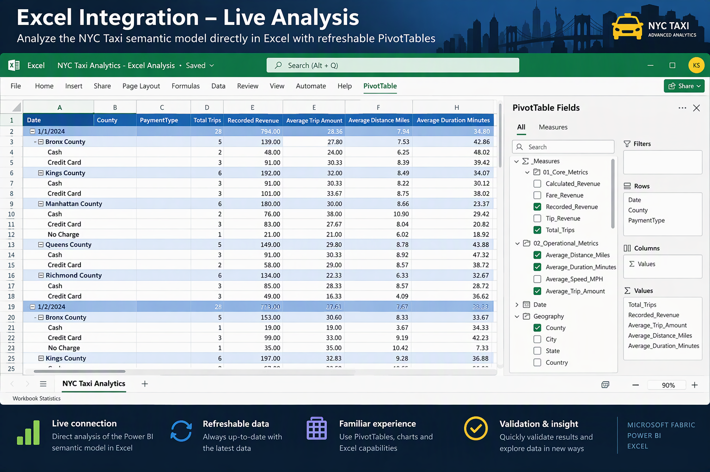

# NYC Taxi Advanced Analytics in Microsoft Fabric

An end-to-end analytics portfolio project built with Microsoft Fabric Warehouse, Power BI, Excel, SQL, DAX, TMDL, Direct Lake on SQL, and GitHub integration.

The solution transforms the Wide World Importers taxi sample into a validated analytical model with financial reconciliation controls, operational KPIs, weather analysis, geographic analysis, six interactive Power BI report pages, and live Excel analysis.


## Project objectives

- Build a reusable analytical layer in Microsoft Fabric Warehouse.
- Create a structured Power BI semantic model with active and inactive relationships.
- Develop advanced DAX measures for finance, operations, time intelligence, weather, ranking, and data quality.
- Reconcile recorded and calculated trip revenue without overwriting source data.
- Deliver a multi-page Power BI report designed for executive and analytical use.
- Connect Excel directly to the Power BI semantic model for refreshable PivotTable analysis and result validation.
- Version the Fabric workspace through native GitHub integration.
- Provide reproducible SQL validation and portfolio-ready documentation.

## Solution architecture

```text
Wide World Importers sample data
              |
              v
Microsoft Fabric Warehouse
WWIAnalyticsWarehouse
              |
              v
dbo.vw_TripAnalytics
Analytical SQL view and quality controls
              |
              v
Power BI semantic model
NYC Taxi Analytics
              |
              v
Power BI report
NYC Taxi Advanced Analytics
              |
              v
Excel live analysis
Refreshable PivotTables and validation
              |
              v
GitHub integration and version control
```

## Technology stack

| Layer | Technology |
|---|---|
| Data platform | Microsoft Fabric |
| Storage | Fabric Warehouse |
| Analytical SQL | T-SQL |
| Semantic model | Power BI semantic model |
| Query mode | Direct Lake on SQL, with view-based DirectQuery fallback where required |
| Business logic | DAX |
| Model metadata | TMDL |
| Reporting | Power BI |
| Connected analysis | Excel with a live Power BI semantic-model connection |
| Validation | Excel PivotTables, SQL control totals, and DAX queries |
| Source control | GitHub and Fabric Git integration |
| Documentation | Markdown and PNG evidence |

## Fabric items

| Fabric item | Purpose |
|---|---|
| `WWIAnalyticsWarehouse` | Source tables and analytical SQL view |
| `NYC Taxi Analytics` | Semantic model, relationships, calendar sorting, and DAX measures |
| `NYC Taxi Advanced Analytics` | Six-page Power BI report |

## Data model

The model uses `vw_TripAnalytics` as the analytical fact source and the following dimensions:

- `Date`
- `Time`
- `Geography`
- `Medallion`
- `HackneyLicense`
- `Weather`

Active relationships support pickup-based analysis. Inactive relationships support drop-off time and drop-off geography analysis through `USERELATIONSHIP`.



## Fabric Warehouse

The SQL layer preserves the source data and adds analytical attributes through `dbo.vw_TripAnalytics`:

- recorded revenue,
- calculated revenue,
- reconciliation difference,
- reconciliation status,
- average speed,
- revenue per mile,
- tip rate.



## DAX measure framework

The semantic model contains 38 explicit measures organized into eight display folders:

1. Core Metrics
2. Operational Metrics
3. Financial Metrics
4. Data Quality
5. Time Intelligence
6. Weather
7. Alternative Relationships
8. Rankings

Representative measures include:

- `Total_Trips`
- `Recorded_Revenue`
- `Calculated_Revenue`
- `Average_Trip_Amount`
- `Revenue_Per_Mile`
- `Reconciliation_Rate`
- `Revenue_MTD`
- `Revenue_YTD`
- `Revenue_MoM_Change_Percent`
- `Trips_By_Dropoff_Geography`
- `Payment_Type_Rank_By_Revenue`

## Report pages

### 1. Executive Overview

Executive KPIs, monthly revenue, payment-type performance, and pickup-county revenue.


### 2. Operational Analysis

Trip volume, distance, duration, speed, time-of-day patterns, weekday activity, and county-level duration.



### 3. Financial & Data Quality

Recorded versus calculated revenue, reconciliation exceptions, exception rate, and financial-quality KPIs.



### 4. Weather Impact

Temperature, precipitation, trip volume, revenue, and monthly weather comparisons.



### 5. Geographic Analysis

Revenue, average trip value, and average trip duration by pickup county.



### 6. Detailed Analysis

Daily, county, and payment-type detail with interactive month, county, and payment filters.



## Excel integration and validation

Excel connects live to the `NYC Taxi Analytics` semantic model and reuses the governed DAX measures defined in Power BI. The workbook provides a refreshable PivotTable for independent exploration and validation without exporting or duplicating the underlying dataset.

The Excel analysis uses:

- rows: `Date`, `County`, and `PaymentType`,
- values: `Total_Trips`, `Recorded_Revenue`, `Average_Trip_Amount`, `Average_Distance_Miles`, and `Average_Duration_Minutes`,
- a live connection to the Power BI semantic model,
- refreshable calculations governed by the same DAX logic used in the report.

This completes the intended analytical flow:

```text
Fabric Warehouse → Semantic Model → Power BI → Excel → GitHub
```



## Validated results

| Metric | Validated value |
|---|---:|
| Analytical rows | 10,000 |
| Active dates | 365 |
| Recorded revenue | 285,930.00 |
| Calculated revenue | 286,080.00 |
| Reconciliation difference | -150.00 |
| Reconciled trips | 5,930 |
| Exception trips | 4,070 |
| Reconciliation rate | 59.30% |
| Average speed | 20.57 mph |
| Revenue per mile | 3.58 |
| Tip rate | 12.49% |
| Final SQL validation | PASS |

## Data-quality approach

The project intentionally preserves the recorded source amount instead of rewriting it.

For every trip, the analytical view calculates:

```text
CalculatedTotalAmount =
    FareAmount
  + SurchargeAmount
  + TaxAmount
  + TipAmount
  + TollsAmount
```

The difference is retained as an auditable metric:

```text
ReconciliationDifference =
    RecordedTotalAmount - CalculatedTotalAmount
```

The validation identified 4,070 exceptions with differences limited to `-2`, `-1`, `1`, or `2`, and a total reconciliation difference of `-150.00`.

## Repository structure

```text
.
├── NYC Taxi Advanced Analytics.Report/
├── NYC Taxi Analytics.SemanticModel/
├── WWIAnalyticsWarehouse.Warehouse/
├── docs/
│   ├── architecture.md
│   └── validation.md
├── images/
│   ├── 01-nyc-taxi-executive-overview.png
│   ├── 02-nyc-taxi-operational-analysis.png
│   ├── 03-nyc-taxi-financial-data-quality.png
│   ├── 04-nyc-taxi-weather-impact.png
│   ├── 05-nyc-taxi-geographic-analysis.png
│   ├── 06-nyc-taxi-detailed-analysis.png
│   ├── 07-nyc-taxi-semantic-model.png
│   ├── 08-nyc-taxi-fabric-warehouse.png
│   └── 09-nyc-taxi-excel-live-analysis.png.png
├── sql/
│   ├── 01_create_vw_TripAnalytics.sql
│   └── 02_validate_solution.sql
├── LICENSE
└── README.md
```

## Reproduce the project

### Prerequisites

- Microsoft Fabric capacity or active Fabric trial
- Fabric workspace administrator access for Git integration
- GitHub repository access
- Fine-grained GitHub token with `Contents: Read and write`
- Excel with access to Power BI semantic models
- Build permission on the `NYC Taxi Analytics` semantic model or Contributor access to its workspace

### Deployment

1. Create or load the Wide World Importers taxi sample warehouse in Microsoft Fabric.
2. Run `sql/01_create_vw_TripAnalytics.sql` in `WWIAnalyticsWarehouse`.
3. Connect the Fabric workspace to this GitHub repository and the `main` branch.
4. Synchronize the warehouse, semantic model, and report.
5. Run `sql/02_validate_solution.sql`.
6. Confirm that `Final_SQL_Validation_Status` returns `PASS`.
7. In Excel, use `Insert → PivotTable → From Power BI` and select `NYC Taxi Analytics`.
8. Recreate the validation PivotTable and refresh the live connection to confirm the model results.

## Git integration

The repository is connected directly to the Microsoft Fabric workspace. Fabric versions the following supported workspace items:

- Warehouse
- Semantic model
- Power BI report

Documentation, Power BI and Excel screenshots, validation notes, and standalone SQL scripts are maintained alongside the Fabric-generated project definitions.

## Key engineering decisions

- Source tables remain unchanged.
- Financial discrepancies are exposed as data-quality KPIs.
- Weather relates to the model through `DateID` only because the source contains one weather record per date.
- Pickup relationships are active.
- Drop-off relationships are inactive and activated only in dedicated DAX measures.
- Calendar labels are sorted through technical date and ordinal columns.
- Excel reuses governed semantic-model measures instead of duplicating business logic.
- Uniform synthetic distributions are not presented as meaningful rankings.

## Skills demonstrated

Microsoft Fabric, Fabric Warehouse, Power BI, Excel live connections, PivotTables, Direct Lake on SQL, T-SQL, DAX, TMDL, star-schema modelling, inactive relationships, time intelligence, financial reconciliation, data-quality controls, report design, GitHub integration, validation, and technical documentation.

## Limitations

- The dataset is synthetic.
- Several count distributions are intentionally uniform.
- The analytical fact source is a SQL view, which can cause DirectQuery fallback for some report queries.
- Year-over-year measures require prior-year data to return meaningful comparisons; the current active dataset covers 2024.
- Excel validation requires access to the Power BI semantic model and permission to build content from it.

## License

This project is licensed under the [MIT License](LICENSE).
