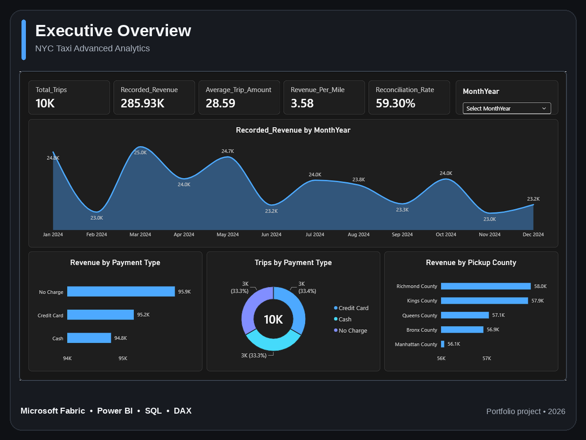

# NYC Taxi Advanced Analytics

An end-to-end Microsoft Fabric and Power BI portfolio project built on the WWI taxi sample warehouse. The solution combines a validated SQL analytical layer, a star-schema semantic model, advanced DAX measures, financial reconciliation controls, and a six-page Power BI report.



## Solution scope

- Microsoft Fabric Warehouse with seven source tables and one analytical SQL view
- Power BI semantic model with active and inactive relationships
- 38 DAX measures organized into eight display folders
- Six report pages: Executive, Operational, Financial & Data Quality, Weather, Geographic, and Detailed Analysis
- SQL and DAX validation against fixed control totals
- LinkedIn-ready visual evidence

## Validated results

| Metric | Value |
|---|---:|
| Trips | 10,000 |
| Active dates | 365 |
| Recorded revenue | 285,930.00 |
| Calculated revenue | 286,080.00 |
| Reconciliation difference | -150.00 |
| Reconciled trips | 5,930 |
| Exception trips | 4,070 |
| Reconciliation rate | 59.30% |

## Repository structure

```text
.
├── docs/
│   ├── architecture.md
│   └── validation.md
├── images/
├── sql/
│   ├── 01_create_vw_TripAnalytics.sql
│   └── 02_validate_solution.sql
├── .gitignore
├── LICENSE
└── README.md
```

## Deployment order

1. Load the WWI sample warehouse in Microsoft Fabric.
2. Run `sql/01_create_vw_TripAnalytics.sql`.
3. Create or synchronize the semantic model and report through Fabric Git integration.
4. Run `sql/02_validate_solution.sql` and confirm `PASS`.

## Technology

Microsoft Fabric, Fabric Warehouse, Power BI, Direct Lake on SQL, SQL, DAX, TMDL, GitHub.

## Notes

The dataset is synthetic. Several distributions are intentionally uniform, so the report prioritizes value, duration, reconciliation, weather, and geographic comparisons over non-informative count rankings.
